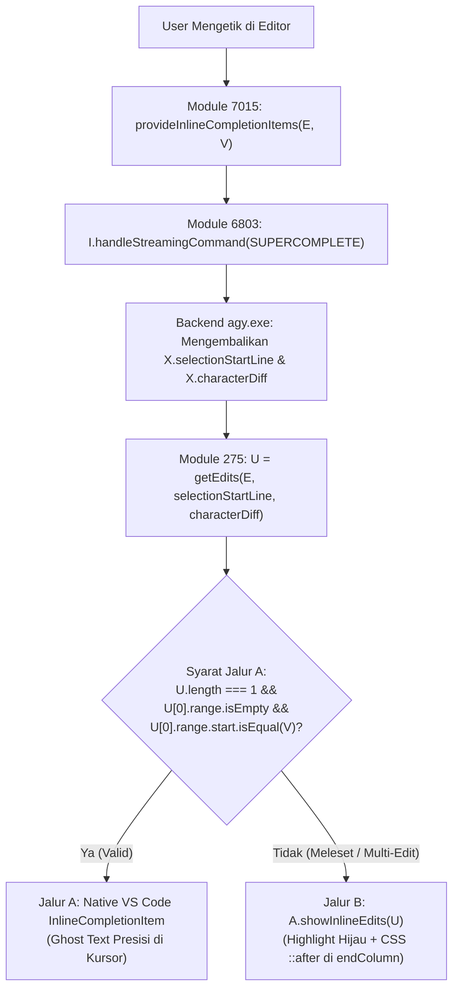
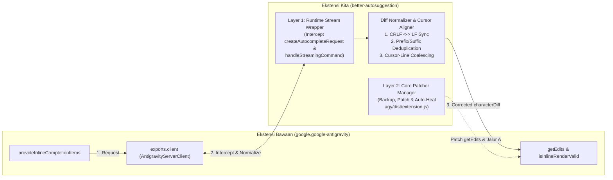

# Product Requirements Document (PRD): Better Autosuggestion for Antigravity IDE

| Metadata | Detail |
| :--- | :--- |
| **Nama Proyek** | `better-autosuggestion` |
| **Target Platform** | Google Antigravity IDE (Windows / macOS / Linux) |
| **Target Ekstensi Bawaan** | `google.google-antigravity` (`resources/app/extensions/agy`) |
| **Mesin AI** | 100% Integrated Antigravity AI (`AntigravityServerClient` / `agy.exe --hub`) |
| **Status Dokumen** | v1.0 — Ready for Implementation |

---

## 1. Ringkasan Eksekutif (Executive Summary)

**Better Autosuggestion** adalah ekstensi untuk **Antigravity IDE** yang dirancang khusus untuk memperbaiki regresi pada fitur *Integrated Autocomplete* (*Antigravity Tab / Supercomplete*).

Pada versi bawaan Antigravity IDE saat ini, posisi *ghost text* (teks abu-abu yang tinggal ditekan `Tab`) sering muncul di kolom yang salah—terutama pada sistem operasi Windows (file dengan line-ending `CRLF`) atau ketika kursor berada di sebelum karakter penutup seperti `;`, `)`, `}`, atau `]`. Ketika pengguna menekan `Tab`, teks disisipkan di tengah-tengah kode yang sudah ada dan memicu saran berikutnya yang semakin merusak baris kode.

Proyek ini menyelesaikan masalah tersebut melalui arsitektur **Non-Intrusive Middleware Wrapper & Smart Patcher**:
- **100% menggunakan AI bawaan Antigravity** (tanpa model eksternal dan tanpa API key tambahan).
- **0% konflik (*Zero Collision*)** dengan sistem autocomplete bawaan IDE.
- **Mempertahankan seluruh fitur bawaan** seperti *Tab to Jump*, *Tab to Import*, dan *Completion Telemetry*.

---

## 2. Latar Belakang & Analisis Akar Masalah (Root Cause Analysis via REA)

### 2.1. Gejala Masalah di Dunia Nyata
Contoh kasus nyata saat mengetik kode berikut (dengan posisi kursor `|` berada tepat sebelum `;`):

```ts
const currentYear = |;
```

- **Ekspektasi:**
  Teks abu-abu `2026` muncul tepat di posisi kursor `|`:
  ```ts
  const currentYear = 2026;
  ```
- **Kenyataan (Bug Bawaan):**
  Teks abu-abu `2026` justru muncul **5 karakter di sebelah kiri kursor** (di antara huruf `e` dan `a`) disertai sorotan baris berwarna hijau:
  ```ts
  const currentYe2026ar = |;
  ```
  Jika pengguna menekan `Tab`, baris berubah menjadi `const currentYe2026ar = ;`, lalu Antigravity langsung memberikan saran baru yang juga bergeser ke kiri secara beruntun.

---

### 2.2. Hasil Reverse Engineering (REA) pada Arsitektur Bawaan
Berdasarkan analisis statis menggunakan **REA** terhadap `agy/dist/extension.js` (`ev_9dde4186a60a924044f0f887827c01314528c864e6d6da42a81dc83d9b79ea01`) dan `workbench.desktop.main.js`:



Ditemukan **4 akar masalah teknis** yang menyebabkan regresi ini:

#### Akar Masalah 1: Bug Pergeseran Offset `CRLF` (`\r\n`) vs `LF` (`\n`) di `getEdits()` (`Module 275`)
Di dalam `Module 275` (`agy/dist/extension.js`):
```js
let Z = E.offsetAt(new c.Position(A, 0)); // A = selectionStartLine
// ...
V === b.DiffChangeType.UNCHANGED ? (N(), Z += E.text.length)
: V === b.DiffChangeType.INSERT ? X.push(E)
: V === b.DiffChangeType.DELETE && (e.push(E), Z += E.text.length);
```
- Pada file dengan line-ending **CRLF (`\r\n`)** (standar di Windows), fungsi `E.offsetAt()` dan `E.positionAt(Z)` milik VS Code menghitung setiap pergantian baris sebagai **2 karakter (`\r\n`)**.
- Sebaliknya, potongan teks di dalam `X.characterDiff.changes` yang dikirim oleh backend `agy.exe` menggunakan **`\n` (1 karakter per baris)**.
- **Dampak Matematis:** Jika `selectionStartLine` berada $K$ baris di atas kursor (misalnya $K = 5$ baris), maka nilai akumulator `Z` akan **kekurangan $K$ karakter**. Saat dikonversi dengan `E.positionAt(Z)`, posisi penyisipan bergeser **$K$ karakter ke kiri dari kursor** (tepat menjelaskan mengapa `2026` bergeser 5 karakter ke kiri dari `|;` ke antara `Ye` dan `ar`).

#### Akar Masalah 2: Kegagalan Masuk ke Jalur A (*Native Ghost Text*) Akibat Syarat yang Terlalu Kaku (`Module 7015`)
Di dalam `Module 7015` (`agy/dist/extension.js`):
```js
if (1 === U.length && U[0].range.isEmpty && U[0].range.start.isEqual(V)) {
  const V = new c.InlineCompletionItem(E, U[0].range);
  return [V];
}
```
- Karena `U[0].range.start` bergeser ke kiri akibat Akar Masalah 1 (atau ketika diff menyentuh karakter penutup `;` / `)` di kanan kursor sehingga `U[0].range.isEmpty` bernilai `false` atau `U.length > 1`), syarat di atas gagal (`false`).
- Akibatnya, completion dibelokkan ke **Jalur B (`A.showInlineEdits(U)`)** yang merender sorotan baris hijau dan menaruh teks abu-abu di posisi yang salah, lalu saat `Tab` ditekan (`supercompleteAccept`), `E.edit()` langsung menyuntikkan teks ke `U[0].range` yang salah tersebut.

#### Akar Masalah 3: Rendering `showInlineEdits` di `endColumn` (`workbench.desktop.main.js`)
Pada class `cOe` (`editor.contrib.antigravityInlineCompletionsController`) dan `rQi`:
- Edit yang me-*replace* karakter ditempatkan pada `endColumn` sebagai dekorasi CSS `::after` (`.inline-edit-decoration`), sementara teks yang dihapus hanya diberi garis bawah tanpa disembunyikan dari tata letak baris.

#### Akar Masalah 4: Pemblokiran Multiline Completion di Tengah Baris (`isInlineRenderValid` di `Module 275`)
Di dalam `Module 275`:
```js
if (R.newText.includes("\n")) {
  const l = E.lineAt(V).text.length;
  if (R.range.start.character < l) return !0; // Dianggap TIDAK VALID!
}
```
- Jika kursor berada di tengah kurung (contoh: `function foo() { | }` atau `arr.map(x => |)`) atau ada spasi di kanan kursor, `start.character < line.text.length` bernilai `true` sehingga saran multiline dibatalkan seluruhnya. Padahal `vscode.InlineCompletionItem` bawaan VS Code sanggup merender multiline completion di tengah kurung dengan sangat rapi.

---

## 3. Tujuan & Sasaran Produk (Product Objectives)

1. **Akurasi Posisi 100% (Zero Offset Drift):**
   Menjamin posisi *ghost text* selalu presisi di titik kursor baik pada file `CRLF` (`\r\n`) maupun `LF` (`\n`), terlepas dari seberapa jauh `selectionStartLine` berada di atas kursor.
2. **Prioritas Native VS Code Ghost Text:**
   Mengutamakan penggunaan `vscode.InlineCompletionItem` bawaan VS Code untuk semua completion yang terjadi pada baris kursor (termasuk ketika terdapat karakter penutup `;`, `)`, `}`, `]`, `"`, `'` di sebelah kanan kursor atau multiline completion di dalam blok `{ | }`).
3. **100% AI Bawaan & Zero Collision:**
   Tidak membuat request ganda, tidak mematikan indikator status Antigravity, dan tetap menggunakan mesin `AntigravityServerClient` (`agy.exe`) bawaan IDE.
4. **Tahan Terhadap Update IDE (Self-Healing):**
   Tetap berfungsi secara otomatis meskipun Antigravity IDE melakukan pembaruan versi di latar belakang (`resources/app` maupun staging `_/resources/app`).

---

## 4. Arsitektur Solusi

Untuk mencapai keandalan maksimal tanpa tabrakan, `better-autosuggestion` menggunakan arsitektur **Dual-Layer (In-Memory Runtime Wrapper + Optional Core Patcher)**:



### 4.1. Layer 1: In-Memory Runtime Wrapper (Aktif Instan Tanpa Restart)
Fungsi `activate()` pada ekstensi bawaan `google.google-antigravity` mengembalikan objek API:
```ts
{
  csrfToken: string,
  readonly port: number,
  client: AntigravityServerClient,
  getRpcClient: () => Promise<Client<typeof LanguageServerService>>
}
```
Objek `client` tersebut adalah *instance* `I` yang sama persis dengan yang dipakai oleh `provideInlineCompletionItems` bawaan.

Saat `better-autosuggestion` aktif, Layer 1 akan:
1. Mengambil `const agyApi = await vscode.extensions.getExtension('google.google-antigravity')?.activate()`.
2. Membungkus (*wrap*) metode `agyApi.client.createAutocompleteRequest` dan `agyApi.client.handleStreamingCommand`:
   - **Step A — Rekam Konteks Request:** Menyimpan metadata dokumen dari request aktif (`lineEnding: "\r\n" | "\n"`, `cursorOffset`, `text`).
   - **Step B — Normalisasi CRLF pada `characterDiff`:**
     Ketika `handleStreamingCommand` menghasilkan chunk `X.characterDiff.changes`, jika dokumen menggunakan `CRLF` (`\r\n`), setiap newline `\n` (yang belum memiliki `\r`) di dalam chunk bertipe `UNCHANGED` (3) dan `DELETE` (2) dinormalisasi menjadi `\r\n`.
     Dengan demikian, saat `getEdits()` bawaan menghitung `Z += change.text.length`, panjang string di `characterDiff` **100% identik** dengan indeks offset di `vscode.TextDocument` (`E.offsetAt` / `E.positionAt`).
   - **Step C — Normalisasi Prefix/Suffix di Baris Kursor (*Cursor-Anchor Snap*):**
     Jika `X.characterDiff.changes` melakukan *delete* lalu *insert* ulang pada teks yang sebenarnya tidak berubah di sekitar kursor (atau memodifikasi karakter penutup di baris yang sama), normalizer merapikan urutan chunk `UNCHANGED` / `INSERT` / `DELETE` sehingga titik perubahan jatuh tepat pada `cursorOffset`.

### 4.2. Layer 2: Core Patcher pada `agy/dist/extension.js` (Dukungan Penuh Native Ghost Text & Multiline)
Untuk memperbaiki keterbatasan logika di `Module 275` dan `Module 7015` yang tidak bisa diubah hanya dari stream RPC (seperti syarat `1 === U.length && U[0].range.isEmpty` dan pemblokiran multiline `isInlineRenderValid`), Layer 2 menyediakan *Smart Patcher* untuk file `agy/dist/extension.js`:
1. **Patch `getEdits` (`Module 275`):**
   Menghitung panjang karakter `UNCHANGED` dan `DELETE` dengan menyesuaikan terhadap `E.eol === c.EndOfLine.CRLF`.
2. **Patch `isInlineRenderValid` (`Module 275`):**
   Mengizinkan multiline render meskipun kursor berada sebelum karakter penutup di baris yang sama.
3. **Patch Jalur A `InlineCompletionItem` (`Module 7015`):**
   Memperluas syarat Jalur A:
   - Jika seluruh edit di `U` berada pada baris kursor (`V.line`) dan dimulai pada atau setelah posisi kursor (`U[0].range.start.character >= V.character`), atau menggantikan suffix pada baris kursor (misal `;`, `)`, `}`), maka gabungkan (*coalesce*) menjadi **satu `vscode.InlineCompletionItem(combinedText, combinedRange)`**.
   - Dengan demikian, VS Code akan menanganinya sebagai **Native Ghost Text** (teks abu-abu standar yang rapi, mendukung `Tab` dan `Ctrl+Right`, tanpa sorotan hijau `showInlineEdits` yang mengganggu).
4. **Backup & Multi-Folder Support:**
   - Menyimpan cadangan asli di `extension.js.better-backup`.
   - Mendukung pemindaian otomatis pada folder aktif (`resources/app/extensions/agy/dist/extension.js`) maupun folder staging update (`_/resources/app/extensions/agy/dist/extension.js`).

---

## 5. Spesifikasi Fitur & Antarmuka Pengguna

### 5.1. Command Palette (`contributes.commands`)
| Command ID | Judul di Command Palette | Fungsi |
| :--- | :--- | :--- |
| `better-autosuggestion.status` | `Better Autosuggestion: Show Status & Diagnostics` | Menampilkan status Runtime Wrapper, status Core Patch, statistik jumlah completion yang telah dikoreksi, dan membuka log diagnostik. |
| `better-autosuggestion.applyPatch` | `Better Autosuggestion: Apply Core Patch to Antigravity` | Menerapkan patch ke `agy/dist/extension.js` (beserta backup otomatis) dan menawarkan *Reload Window*. |
| `better-autosuggestion.restorePatch` | `Better Autosuggestion: Restore Original Antigravity Extension` | Mengembalikan `agy/dist/extension.js` dari file backup asli. |
| `better-autosuggestion.toggle` | `Better Autosuggestion: Toggle Enable/Disable` | Mengaktifkan atau menonaktifkan koreksi autosuggestion secara cepat. |

### 5.2. Pengaturan Ekstensi (`contributes.configuration`)
| Setting Key | Tipe | Default | Deskripsi |
| :--- | :--- | :--- | :--- |
| `betterAutosuggestion.enabled` | `boolean` | `true` | Mengaktifkan wrapper & koreksi posisi autosuggestion. |
| `betterAutosuggestion.fixCrlfDrift` | `boolean` | `true` | Menormalisasi perbedaan panjang newline `CRLF` (`\r\n`) vs `LF` (`\n`) pada `characterDiff`. |
| `betterAutosuggestion.preferNativeGhostText` | `boolean` | `true` | Mengonversi edit pada baris kursor menjadi Native VS Code Ghost Text (`InlineCompletionItem`) agar tidak memicu blok highlight hijau (`showInlineEdits`). |
| `betterAutosuggestion.allowMidLineMultiline` | `boolean` | `true` | Mengizinkan multiline completion saat kursor berada di tengah baris (misal di dalam `{ \| }` atau `( \| )`). |
| `betterAutosuggestion.autoPatchCoreExtension` | `boolean` | `true` | Otomatis menerapkan dan menjaga patch pada `agy/dist/extension.js` (termasuk setelah Antigravity IDE update). |
| `betterAutosuggestion.debugLogging` | `boolean` | `false` | Mencetak detail posisi *before vs after* setiap autosuggestion ke Output Channel `Better Autosuggestion`. |

### 5.3. Status Bar Item
- Menampilkan indikator ringkas di Status Bar kanan bawah: `$(sparkle) AutoSuggest: Fixed` (atau `$(warning) AutoSuggest: Needs Reload` jika patch baru diterapkan).
- Klik pada Status Bar akan membuka menu cepat (*QuickPick*) untuk melihat statistik koreksi, *Toggle On/Off*, *Apply/Restore Patch*, atau membuka Output Log.

---

## 6. Struktur Direktori Proyek

```text
c:\Personal\better-autosuggestion\
├── PRD.md                        # Dokumen spesifikasi produk ini
├── package.json                  # Manifest ekstensi VS Code / Antigravity
├── tsconfig.json                 # Konfigurasi kompilasi TypeScript
├── src/
│   ├── extension.ts              # Entry point ekstensi, registrasi command & status bar
│   ├── runtimeWrapper.ts         # Layer 1: In-memory interceptor pada agy.client
│   ├── diffNormalizer.ts         # Algoritma koreksi CRLF drift, common-affix & cursor snap
│   ├── corePatcher.ts            # Layer 2: Patcher & backup manager untuk agy/dist/extension.js
│   └── logger.ts                 # OutputChannel logger & telemetry penghitung koreksi
└── test/
    └── diffNormalizer.test.ts    # Unit test kasus nyata (termasuk kasus const currentYear = ; di CRLF)
```

---

## 7. Kriteria Keberhasilan (Acceptance Criteria)

1. **Kasus Uji 1 — `const currentYear = |;` pada File CRLF (Windows):**
   - Ketika ada $\ge 1$ baris di atas baris kursor pada file `CRLF`, saran `2026` **harus** muncul tepat setelah `= ` dan sebelum `;` (`const currentYear = 2026;`), **bukan** di antara `Ye` dan `ar` (`const currentYe2026ar = ;`).
   - Saat ditekan `Tab`, hasil akhirnya tepat `const currentYear = 2026;` tanpa merusak teks di sebelah kiri kursor.
2. **Kasus Uji 2 — Completion di Tengah Kurung / Kutip (`console.log(|);`):**
   - Ketika model menyarankan argumen di dalam kurung atau memodifikasi akhir baris yang sama, saran tampil sebagai *Native Ghost Text* di posisi kursor tanpa menggeser atau menumpuk teks lama.
3. **Kasus Uji 3 — Multiline Completion di Dalam Blok (`function test() { | }`):**
   - Ketika kursor berada di antara `{` dan `}`, saran multiline tetap muncul dengan rapi.
4. **Kasus Uji 4 — Zero Collision & Kemudahan Rollback:**
   - Tidak ada *double request* ke `agy.exe`.
   - Command `Restore Original Antigravity Extension` dapat mengembalikan file `agy/dist/extension.js` ke byte/SHA-256 semula kapan saja.

---

## 8. Tahapan Implementasi (Implementation Roadmap)

1. **Tahap 1 — Scaffolding & Core Engine (`diffNormalizer.ts`):**
   Inisialisasi proyek TypeScript ekstensi VS Code dan implementasi algoritma normalisasi `CRLF` serta *cursor-line edit coalescing* beserta unit test kasus `const currentYear = ;`.
2. **Tahap 2 — Layer 1 (`runtimeWrapper.ts`) & Layer 2 (`corePatcher.ts`):**
   Implementasi interceptor `agy.client` di memori dan modul patcher otomatis untuk `agy/dist/extension.js` (mendukung folder utama dan folder update `_`).
3. **Tahap 3 — UI Integrasi (`extension.ts`), Packaging (`.vsix`) & Aktivasi Langsung:**
   Menghubungkan Status Bar, Command Palette, mengompilasi ekstensi, menerapkan patch ke Antigravity IDE di perangkat ini, dan memaketkannya menjadi file `.vsix` siap pasang.

